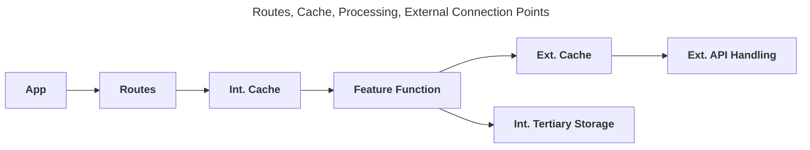

# CROWSNEST-backend

# 
There exist a multitude of sources, that provide overlapping information.
each "TBDsector" uses a set of those sources to organize information about a specific subject. 

Gather Data 
make sense of data 
display data  

# System Design 

That Feature function would seem to be the most hefty piece there.
st. it would: 
- take parameters from the user 
- check internal cache 
- determine which set of sources to call 
- determine if the data returned by source is trust worth. 
- put together responses from each of the sources to estimate an objective answer. 
- determine if it needs to be stored in internal tertiary storage. 

So this would definitely be separated into separate functions. 

##### Organized Plan 
Ok; there are a couple things to consider. 
###### FEATURE 
- Processing the **parameters** that I offer for my feature. (which should determine what kind of data i need to return.) 
- **Caching** for my feature. 
	- get global inner cache timer variable 

###### CONNECTOR 
- Feature parameters has to determine which/how many of **multiple *sources*** to call on. *must note which sources are ultimately used.* (and prep their parameters) 
	Based on: 
	- Data is availability 
	- Data trustability (some sort of trust list from an api controller) 
	- Feature Parameters 
- that response data then needs to be **processed**, so it has the shape of the application 

###### SOURCE FETCHER 
- Check **Cache** of the source 
	- get global outer cache timer variable 
- Prepare **parameters** for the external API's data. 
- Check source data response **validity**; Return it. 

